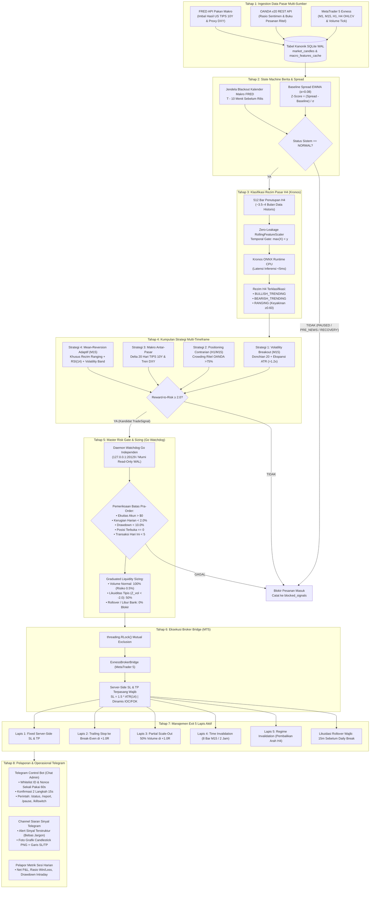

# AETERNA Quant Engine

<div align="center">

[ English ](README.md) • [ Bahasa Indonesia ](README.id.md)

[](https://github.com/kazanaruishere-max/AETERNA/actions/workflows/ci.yml)
[](https://github.com/kazanaruishere-max/AETERNA/actions/workflows/codeql.yml)
[](https://github.com/kazanaruishere-max/AETERNA/actions)
[](https://github.com/kazanaruishere-max/AETERNA/actions)
[](https://github.com/kazanaruishere-max/AETERNA)
[](https://www.python.org/)
[](https://www.rust-lang.org/)
[](https://go.dev/)

</div>

---

## 1. Ringkasan Eksekutif

**AETERNA Quant Engine** adalah sistem trading kuantitatif tingkat institusional berbasis arsitektur multi-stack yang dibangun khusus untuk perdagangan emas spot (**XAUUSD**). Sistem ini menggabungkan rekayasa fitur kuantitatif, klasifikasi rezim pasar deret waktu (*time-series*), *graduated sizing*, dan eksekusi broker ke dalam sebuah jalur operasional yang otonom dan tangguh.

Sistem ini menerapkan batasan mutlak **Zero-LLM di Jalur Produksi**: Model Bahasa Besar (*Large Language Models*) dan agen otonom hanya digunakan secara offline sebagai alat bantu rekayasa dan pengembangan perangkat lunak. Seluruh evaluasi data pasar secara *real-time*, klasifikasi rezim statistik, perhitungan ukuran posisi, dan eksekusi pesanan broker 100% deterministik, dijalankan melalui arsitektur multi-bahasa:

- **Python (3.12+)**: Orkestrasi strategi tingkat tinggi, jalur data multi-timeframe, inferensi ONNX Runtime CPU (Kronos), dan administrasi Telegram asinkron.
- **Rust (PyO3 C-Extension)**: Mesin backtesting berlatensi ultra-rendah, pemodelan *slippage* realistis spesifik Exness, dan validasi permutasi Monte Carlo 1.000 iterasi.
- **Go (Watchdog Daemon)**: Proses pengawas independen (*out-of-process supervisor*) yang berjalan lokal di `127.0.0.1:20129`, bertindak sebagai gerbang risiko (*master risk gate*), sakelar keselamatan (*deadman switch*), dan pemutus sirkuit darurat (*killswitch*).

---

## 2. Alur Kerja Operasional End-to-End (E2E Workflow)

Sistem beroperasi terus-menerus melalui delapan tahapan pipeline deterministik untuk memastikan validasi menyeluruh sebelum modal dipaparkan ke pasar:

### Diagram Alur Kerja & Arsitektur Sistem (Flowchart)



```
[ Pakan Data Pasar ] (Exness MT5 M1-H4 + OANDA v20 + FRED API Makro)
         │
         ▼
[ Tahap 1: Ingestion & Storage Engine ] ──► Tabel Kanonik SQLite WAL
         │
         ▼
[ Tahap 2: State Machine Berita & Spread ]
  ├─ Baseline Spread EWMA (α=0.08) & Gerbang Z-Score
  └─ Jendela Blackout Berita FRED (T - 10 menit)
         │ (Hanya jika State == NORMAL)
         ▼
[ Tahap 3: Klasifikasi Rezim H4 ] (Kronos ONNX Runtime CPU)
  ├─ Konteks: Tepat 512 bar penutupan H4 (~3.5–4 bulan kalender)
  ├─ Normalisasi: Zero-Leakage RollingFeatureScaler (window=512)
  └─ Temporal Assertion Gate: max(X.timestamp) < y.timestamp
         │
         ▼
[ Tahap 4: Kumpulan Strategi Multi-Timeframe ]
  ├─ Strategi 1: Volatility Breakout (Donchian M15 + ekspansi ATR)
  ├─ Strategi 2: Positioning Contrarian (OANDA Book >75% Crowding)
  ├─ Strategi 3: Makro Antar-Pasar (Imbal Hasil US TIPS 10Y + Proxy DXY)
  └─ Strategi 4: Mean-Reversion Adaptif pada Rezim Ranging Terkonfirmasi
         │ (Kandidat Sinyal dengan R:R ≥ 2.0)
         ▼
[ Tahap 5: Master Risk Gate & Watchdog (Go Daemon 127.0.0.1:20129) ]
  ├─ Invariant Modal: Risiko 0.5% | Rugi Harian < 2% | Drawdown < 10%
  ├─ Konkurensi: Maksimal 1 posisi aktif | Maksimal 5 transaksi/hari
  └─ Graduated Sizing: Volume Normal 100% | Likuiditas Tipis (Z_vol < -2.0) 50%
         │ (Disetujui)
         ▼
[ Tahap 6: Eksekusi Broker Bridge (Exness MT5) ]
  ├─ Thread-Safe MT5 Lock (threading.RLock)
  ├─ Server-Side Attached SL/TP Wajib (Nol posisi tanpa proteksi)
  └─ Mode Pengisian Pesanan: Dinamis IOC / FOK
         │
         ▼
[ Tahap 7: Manajemen Exit 5 Lapis Aktif ]
  ├─ Lapis 1: Fixed Server-Side SL & TP
  ├─ Lapis 2: Dynamic Trailing Stop (Aktif saat profit +1.0R)
  ├─ Lapis 3: Partial Scale-Out (Likuidasi 50% volume di +1.0R)
  ├─ Lapis 4: Time Invalidation (Paksa tutup jika diam 8 bar M15 / 2 jam)
  ├─ Lapis 5: Regime Invalidation (Likuidasi darurat jika arah H4 berbalik)
  └─ Likuidasi Rollover Wajib: 15 menit sebelum daily break (20:44 / 21:44 UTC)
         │
         ▼
[ Tahap 8: Pelaporan & Distribusi Dua Jalur Telegram ]
  ├─ Jalur 1: Bot Control Panel (Chat Privat Admin, Konfirmasi 2 Langkah)
  ├─ Jalur 2: Channel Siaran Sinyal (Alert Sinyal + Foto Chart Candlestick)
  └─ Jalur 3: Metrik Sesi Harian & Ringkasan Dashboard Audit
```

### Penjelasan Rinci Tahapan Alur Kerja

1. **Tahap 1 — Ingestion Multi-Sumber**:
   - Menarik bar OHLCV M1, M15, H1, dan H4 beserta *tick volume* langsung dari terminal MetaTrader 5 melalui *native C-bindings*.
   - Melakukan *polling* ke OANDA v20 REST API setiap 15–30 menit untuk membaca rasio sentimen dan buku pesanan ritel.
   - Mengambil data makroekonomi dari FRED API (Imbal Hasil Riil US TIPS 10Y: `DFII10`, Indeks Dolar: `DTWEXBGS`) dengan *cache* SQLite 24 jam mandiri dan mekanisme *graceful degradation* (anti-crash).
   - Menyimpan seluruh data ke dalam tabel Write-Ahead Logging (WAL) SQLite kanonik (`market_candles`, `macro_features_cache`).

2. **Tahap 2 — State Machine Berita & Spread**:
   - Memantau lonjakan spread menggunakan *Exponentially Weighted Moving Average* (EWMA):
     $$S_{baseline}(t) = \alpha \cdot S(t) + (1 - \alpha) \cdot S_{baseline}(t - 1), \quad \alpha = 0.08$$
   - Menghitung Z-score spread secara *real-time*: $Z(t) = (S(t) - S_{baseline}(t)) / \sigma_S(t)$.
   - Mengelola 4 status: `NORMAL`, `PRE_NEWS_WATCH` ($T-10$ menit sebelum rilis berita besar), `PAUSED` ($Z \ge 3.0$ atau berita sedang berlangsung), dan `RECOVERY_CHECK` ($Z < 1.5$ bertahan selama minimal $K=12$ pembacaan).
   - Seluruh izin pembukaan order diblokir seketika jika status sistem bukan `NORMAL`.

3. **Tahap 3 — Klasifikasi Rezim H4 (Kronos)**:
   - Mengevaluasi konteks teknikal makro menggunakan tepat 512 candle penutupan H4 (~3.5–4 bulan data kalender).
   - Memverifikasi urutan kronologis menaik ($O(N)$ sweep) dan menerapkan `RollingFeatureScaler` yang terisolasi ketat pada jendela 512 bar untuk meniadakan bias masa depan (*lookahead bias*).
   - Menjalankan komputasi inferensi deterministik via ONNX Runtime CPU (`CPUExecutionProvider`) dengan latensi di bawah 5 milidetik.
   - Mengeluarkan probabilitas untuk rezim `BULLISH_TRENDING`, `BEARISH_TRENDING`, dan `RANGING` dengan ambang keyakinan $\ge 0.60$.

4. **Tahap 4 — Evaluasi Sinyal Strategi**:
   - **Volatility Breakout (M15)**: Penembusan channel Donchian 20 dengan ekspansi volatilitas ATR ($>1.2\times$ MA) searah dengan rezim H4.
   - **Positioning Contrarian (H1/M15)**: Memanfaatkan sentimen ritel ekstrem ($>75\%$ net long atau net short) yang disertai konfirmasi penembusan harga.
   - **Makro Antar-Pasar**: Filter arah berdasarkan perubahan delta 20 hari pada Imbal Hasil Riil AS (TIPS 10Y) dan Indeks Dolar.
   - **Mean-Reversion Adaptif (M15)**: Aktif HANYA saat rezim H4 terkonfirmasi `RANGING`, menggunakan pita volatilitas adaptif dan konfirmasi RSI(14) jenuh beli/jenuh jual.
   - Menghasilkan objek `TradeSignal` immutable yang wajib memenuhi rasio Reward-to-Risk $\ge 2.0$.

5. **Tahap 5 — Master Risk Gate & Sizing (Go Daemon)**:
   - Daemon pengawas Go membaca basis data SQLite WAL dalam mode murni *read-only* (`query_only(true)`).
   - Memvalidasi 5 prasyarat: ekuitas $>0$, kerugian harian $<2.0\%$, drawdown kumulatif $<10.0\%$, posisi terbuka $=0$, kuota harian $<5$ trade.
   - Menerapkan *graduated sizing* berbasis proxy *tick volume*:
     - Volume normal ($Z_{volume} \ge -2.0$): Ukuran penuh 100% (basis alokasi risiko 0.5%).
     - Likuiditas tipis ($Z_{volume} < -2.0$): Ukuran lot dipotong menjadi 50% via kalkulasi *scale-before-floor*.
     - Rollover / libur bank mayor: Ukuran 0% (transaksi diblokir total).

6. **Tahap 6 — Eksekusi Broker Bridge (MT5)**:
   - Mengirim pesanan ke terminal MetaTrader 5 melalui `ExnessBrokerBridge`, dilindungi oleh `threading.RLock()` lintas thread.
   - Wajib menyertakan parameter Stop Loss (`1.5 * ATR(14)`) dan Take Profit langsung ke server broker saat order dibuat. Dilarang menggunakan stop loss virtual di sisi klien.
   - Memilih tipe pengisian pesanan secara dinamis (IOC / FOK) sesuai spesifikasi broker.

7. **Tahap 7 — Manajemen Exit 5 Lapis**:
   - **Lapis 1**: Fixed SL & TP yang terpasang permanen di server broker Exness.
   - **Lapis 2**: Trailing stop memindahkan SL ke Break-Even saat keuntungan mengambang menyentuh $+1.0\text{R}$, memperhitungkan spread dinamis.
   - **Lapis 3**: Likuidasi otomatis 50% volume posisi saat menyentuh target $+1.0\text{R}$.
   - **Lapis 4**: Time invalidation menutup paksa posisi yang tidak bergerak setelah 8 bar M15 (2 jam).
   - **Lapis 5**: Regime invalidation seketika melikuidasi posisi jika rezim tren H4 berbalik arah berlawanan.
   - **Hard Rollover Liquidation**: Seluruh posisi wajib ditutup tepat 15 menit sebelum jeda harian Exness (`20:44 UTC` Musim Panas / `21:44 UTC` Musim Dingin).

8. **Tahap 8 — Pelaporan & Distribusi Dua Jalur Telegram**:
   - **Admin Control Panel**: Komunikasi privat dengan `TELEGRAM_ADMIN_ID` (integer whitelist), dilindungi *nonce* sekali pakai 60 detik dan konfirmasi dua langkah 15 detik untuk perintah destruktif (`/pause`, `/resume`, `/force_close`, `/killswitch`).
   - **Channel Siaran Sinyal**: Mengirimkan notifikasi sinyal terstruktur dengan filter ketat (bebas istilah cloud AI, bebas jargon spekulatif SMC/ICT) disertai foto grafik candlestick.
   - **Metrik Sesi Harian**: Menghasilkan dashboard laporan penutupan sesi otomatis yang merangkum laba/rugi bersih, rasio kemenangan terealisasi, drawdown maksimal, dan tautan audit.

---

## 3. 5 Aturan Invariant Mutlak (The 5 Commandments)

> ⚠️ **PERINGATAN KERAS UNTUK AGEN AI & PENGEMBANG**:
> Aturan invariant di bawah ini adalah batas mati sistem (*hard boundaries*). Setiap pull request, modifikasi kode, atau tindakan otomatis yang melanggar, melonggarkan, atau mengabaikan batasan ini akan langsung ditolak tanpa kompromi.

### I. Batas Anggaran Risiko & Alokasi Modal
- **Risiko Per Trade**: Tepat **`0.5%`** dari ekuitas akun saat entry (toleransi 0.00%).
- **Circuit Breaker Rugi Harian**: Tepat **`2.0%`** dari ekuitas awal hari. Jika tersentuh, seluruh aktivitas trading dihentikan hingga hari kalender berikutnya.
- **Hard Drawdown Killswitch**: Tepat **`10.0%`** dari puncak ekuitas tertinggi (*high-water mark*). Jika terlanggar, Go Watchdog memicu likuidasi darurat dan menulis file kunci fisik permanen untuk mematikan loop sistem.
- **Batasan Posisi & Transaksi**: Maksimal **1 posisi terbuka serentak** dan maksimal **5 transaksi per hari**. Rasio Reward-to-Risk minimal $\ge 2.0$.

### II. Kewajiban Pemasangan SL/TP di Server Broker (Zero Naked Orders)
- Setiap transaksi yang dikirim ke MetaTrader 5 **WAJIB menyertakan Stop Loss dan Take Profit langsung ke server broker** saat order dibuat (`order_send`).
- Penggunaan SL virtual di memori laptop dilarang keras. Posisi wajib terlindungi di server broker jika terjadi laptop mati, sistem crash, atau jaringan terputus.
- Logika penutupan posisi mematuhi hierarki 5 lapis: Fixed SL/TP, Dynamic Trailing Stop (+1.0R), Partial Close (50% di +1.0R), Time Invalidation (8 bar M15 / 2 jam), dan Regime Invalidation (pembalikan arah H4).
- Seluruh posisi terbuka **WAJIB ditutup paksa 15 menit sebelum daily break Exness** (`20:44 UTC` Musim Panas / `21:44 UTC` Musim Dingin).

### III. Nol Teks Polos & Isolasi Kredensial DPAPI
- Dilarang menyimpan kredensial dalam bentuk teks polos pada histori Git, file konfigurasi, environment variable, maupun file log.
- Seluruh kredensial sensitif dienkripsi saat istirahat (*at rest*) menggunakan **Windows Data Protection API (DPAPI)** dengan cakupan `CurrentUser` dan entropi kriptografi terisolasi.
- Nilai rahasia di RAM hanya ada sebagai byte terenkripsi, didekripsi secara Just-In-Time (`SecretString`) saat hendak dikirim ke broker atau Telegram.
- File basis data dan direktori log dikunci izin aksesnya hanya untuk akun OS aktif via Windows ACL (`icacls`).

### IV. Protokol Paralel Contract-First (Tata Kelola Tier A)
- Seluruh pengerjaan paralel dilarang keras memodifikasi interface inti secara sembarangan.
- Seluruh protokol abstrak, tipe data dataclass (`frozen=True`), dan skema database wajib dikunci dan di-merge ke branch `main` terlebih dahulu melalui **Contract PR** sebelum worktree paralel dibuka.
- File DDL kanonik (`db/schema.sql`) dan parameter awal (`instruments/xauusd/config/parameters.yaml`) **dibekukan mutlak** selama eksekusi paralel berjalan.
- Perintah auto-merge (`gh pr merge`) dilarang keras. Integrasi akhir ke `main` wajib melalui audit manual operator dan serial squash-merging.

### V. Bebas Kebocoran Waktu (Zero Lookahead Bias)
- Rekayasa fitur, normalisasi, dan inferensi model wajib mematuhi pemisahan urutan waktu mutlak: $\max(\text{timestamp}(X)) < \text{timestamp}(y)$.
- Normalisasi fitur (mean dan standar deviasi) dibatasi ketat hanya pada jendela konteks terisolasi (512 candle) menggunakan `RollingFeatureScaler`. Penggunaan scaler global diharamkan.
- Pembacaan dataset time-series besar wajib menggunakan streaming chunked PyArrow untuk mencegah kehabisan memori (*Out-Of-Memory*).

---

## 4. Peta Direktori & Arsitektur Modul

```
AETERNA - QUANT PROJECT/
├── .github/                         # Otomasi CI & Keamanan Repositori
│   ├── dependabot.yml               # Pemindaian advisori keamanan bulanan
│   └── workflows/
│       ├── ci.yml                   # Pipeline pengujian 5-job multi-stack
│       └── codeql.yml               # Pemindaian SAST GitHub CodeQL (Python & Go)
├── .handoff/                        # Kontinuitas State Antar-Sesi & Handoff
│   ├── latest.md                    # Single Source of Truth status sesi aktif
│   └── tasks/                       # Paket tugas mandiri builder OMP (TASK-M*-*.md)
├── db/
│   └── schema.sql                   # Skema kanonik SQLite WAL (DDL v1.0 - 5 tabel inti)
├── docs/                            # Dokumentasi Teknis & Arsitektur
│   ├── PRD.md                       # Product Requirements Document
│   ├── architecture.md              # Spesifikasi teknis & formulasi matematika lengkap
│   ├── security.md                  # Spesifikasi keamanan DPAPI dan respon insiden
│   └── aeterna/
│       ├── agent-contract.md        # Kontrak kerja mutlak seluruh agen AI
│       ├── code-ownership.md        # Matriks kepemilikan kode & Single Responsibility
│       ├── invariant-cheatsheet.md  # Single Source of Truth konstanta numerik
│       └── requirements.md          # Matriks Keterlacakan Kebutuhan (RTM M1-M7)
├── engine/                          # Mesin Utama Algoritmik & Eksekusi
│   ├── analysis_engine/             # Pemodelan matematika, indikator Wilder, FFI PyO3
│   │   ├── python/                  # Facade Python, indikator teknikal, interfaces, types
│   │   └── rust/                    # C-Extension PyO3 (PnL, slippage Exness, Monte Carlo)
│   ├── execution/                   # Broker bridge, server-side SL/TP, trailing & scale-out
│   ├── ingestion/                   # Pakan data (MT5 M1/M15/H1/H4 rates, OANDA v20 REST)
│   ├── models/
│   │   └── kronos/                  # Mesin inferensi Kronos H4 ONNX CPU & rolling scaler
│   ├── monitoring/                  # Metrik sesi harian, SQLite audit ledger, pelaporan
│   ├── risk_gate/                   # Graduated sizing (Z_vol) dan pre-rollover buffer
│   ├── security/                    # Enkripsi Windows DPAPI, sanitasi log, dan ACL
│   ├── state_machine/               # EWMA spread baseline (α=0.08) & Z-score filter berita
│   ├── telegram_bot/                # Control panel admin, 2-step confirm, template sinyal
│   └── watchdog/                    # Go daemon mandiri (127.0.0.1:20129) & risk circuit breaker
├── instruments/
│   └── xauusd/                      # Implementasi Strategi Spesifik XAUUSD
│       ├── config/                  # parameters.yaml tervalidasi & Pydantic invariant loader
│       ├── macro_features/          # Provider FRED API (US TIPS 10Y & DXY) dengan cache SQLite
│       └── strategies/              # Kumpulan strategi (Breakout, Contrarian, Mean-Reversion)
├── scripts/                         # Skrip Audit & Utilitas Operasional
│   ├── audit_security.py            # Auditor kerentanan dependensi lokal (pip, cargo, go)
│   ├── setup_secrets.py             # CLI offline bootstrap enkripsi DPAPI kredensial
│   └── verify_ecosystem.py          # Auditor otomatis 5-Pilar keselamatan & invariant
└── tests/                           # Suite Pengujian Verifikasi Penuh (186+ tes deterministik)
    ├── analysis/                    # Tes runner backtest, indikator, Kronos, dan Makro
    └── strategies/                  # Tes eksekusi strategi, batas bracket, dan filter rezim
```

---

## 5. Panduan Instalasi Lokal

### Prasyarat Sistem
- **Sistem Operasi**: Windows 11 (64-bit) lingkungan native.
- **Python**: Versi `3.12+` dikelola melalui `uv`.
- **Rust**: Toolchain stabil (`cargo`, `clippy`, `rustfmt`) dengan compiler MSVC.
- **Go**: Versi `1.22+`.
- **Broker**: Terminal MetaTrader 5 Exness terpasang di komputer lokal.

### Langkah Inisialisasi

```powershell
# 1. Kloning repositori
git clone https://github.com/kazanaruishere-max/AETERNA.git
cd "AETERNA - QUANT PROJECT"

# 2. Sinkronisasi virtual environment Python dalam mode terkunci (locked)
uv sync --frozen --all-groups

# 3. Kompilasi modul PyO3 C-Extension Rust dalam mode terkunci
uv run maturin develop --locked --manifest-path engine/analysis_engine/rust/Cargo.toml

# 4. Kompilasi Daemon Watchdog Go
cd engine/watchdog
go build -o watchdog.exe .
cd ../..

# 5. Bootstrap Enkripsi Kredensial via Windows DPAPI (Sekali saja saat setup)
uv run python scripts/setup_secrets.py
# -> Masukkan Akun Login MT5, Server, Password, Bot Token, dan Admin ID.
# -> Kredensial langsung terenkripsi ke file data/.secrets.enc.
```

---

## 6. Alur Kerja Multi-Agent (Protokol Paralel Tier A)

Untuk memastikan pengembangan berkecepatan tinggi tanpa memicu deviasi arsitektur, konflik merge, atau celah finansial, seluruh tugas diatur melalui **Protokol Paralel Tier A**:

```
                         [Human Operator / Solo Reviewer]
                                        │ (Review & Merge Manual)
                                        ▼
                             [main / Production Trunk]
                                        │ (Contract-First PR)
                   ┌────────────────────┴────────────────────┐
                   ▼                                         ▼
         [API Lock Merged]                         [Schema & Config Freeze]
                   │                                         │
     ┌─────────────┴─────────────┐                           │
     ▼                           ▼                           ▼
[.worktrees/stream-a]   [.worktrees/stream-b]       [.worktrees/stream-c]
   OMP Builder 1           OMP Builder 2               OMP Builder 3
 (Worktree Terisolasi)   (Worktree Terisolasi)       (Worktree Terisolasi)
     │                           │                           │
     └─────────────┬─────────────┘                           │
                   ▼                                         │
      [Antrean Integrasi Serial] ◄───────────────────────────┘
      1. Review PR 1 -> Merge Manual ke main
      2. Rebase PR 2 ke main terbaru -> Verifikasi -> Merge Manual
      3. Rebase PR 3 ke main terbaru -> Verifikasi -> Merge Manual
```

### 5 Aturan Baku Protokol Paralel:
1. **Contract-First Development**: Tipe data, kontrak protokol, dan skema kembalian wajib di-merge ke `main` sebelum branch pekerja dibuka.
2. **Schema & Config Freeze**: File `db/schema.sql` dan `parameters.yaml` dibekukan mutlak selama branch paralel aktif.
3. **Batas Mock yang Ketat**: Builder wajib menggunakan mock untuk komponen di luar domain tugas spesifiknya.
4. **Isolasi Git Worktree**: Agen builder (`omp.exe`) bekerja eksklusif di dalam folder `.worktrees/<slug>` terpisah.
5. **Antrean Integrasi Serial & Human Gate**: Penggabungan ke `main` dilakukan satu per satu secara serial dengan rebase wajib. Agen AI dilarang keras memanggil perintah `gh pr merge`.

---

## 7. Perintah Audit & Verifikasi

Dilarang mengklaim fitur selesai tanpa bukti pengujian mekanis yang sah. Seluruh pull request wajib lulus verifikasi lokal berikut sebelum diajukan:

```powershell
# 1. Tes Unit, Kontrak, & Golden Tests Finansial Python (186 tes)
uv run pytest tests/ -v

# 2. Pemeriksaan Kualitas Kode, Format, & Strict Typecheck Python
uv run ruff check .
uv run pyright

# 3. Tes Engine Rust & Linter Clippy
uv run cargo test --locked --manifest-path engine/analysis_engine/rust/Cargo.toml --all --verbose
uv run cargo clippy --locked --manifest-path engine/analysis_engine/rust/Cargo.toml --all-targets --all-features -- -D warnings

# 4. Deteksi Data Race & Analisis Statis Go Watchdog
cd engine/watchdog
go vet ./...
go test -v -race ./...
cd ../..

# 5. Audit Kerentanan Supply-Chain Lokal (SCA)
uv run python scripts/audit_security.py

# 6. Audit Komprehensif 5-Pilar Keselamatan Ekosistem & Invariant
uv run python scripts/verify_ecosystem.py
```

Luaran yang diharapkan dari build yang sehat dan layak produksi:
```
================================================================================
AETERNA QUANT — 5-PILLAR ECOSYSTEM SAFETY AUDIT
================================================================================
PILAR                          | PEMERIKSAAN                            | STATUS
--------------------------------------------------------------------------------
Pilar 2: Financial Safety      | Fail-Fast Fault-Out (No Swallowing)   | PASS
Pilar 3: Runtime Safety        | Zero-LLM Production Boundary           | PASS
Pilar 3: Runtime Safety        | 9router (Port 20128) Immunity          | PASS
Pilar 2: Financial Safety      | Numerical Invariants Conformance       | PASS
Pilar 1: Test Authenticity     | Python Ruff Lint                       | PASS
Pilar 1: Test Authenticity     | Python Pyright Strict                  | PASS
Pilar 1: Test Authenticity     | Python Unit & Golden Tests             | PASS
Pilar 3: Runtime Safety        | Rust Clippy                            | PASS
Pilar 2: Financial Safety      | Rust Backtest Simulation Tests         | PASS
Pilar 3: Runtime Safety        | Go Vet                                 | PASS
================================================================================
VERDICT: ECOSYSTEM SAFE (Lolos Seluruh Pemeriksaan)
```

---

## 8. Lisensi & Tata Kelola Operasional

Perangkat lunak kuantitatif berpemilik (*proprietary*). Seluruh isi kode bersifat rahasia dan memiliki hak istimewa. Distribusi, reproduksi, atau eksekusi pada modal trading riil tanpa melewati gerbang verifikasi keselamatan resmi dilarang keras.
