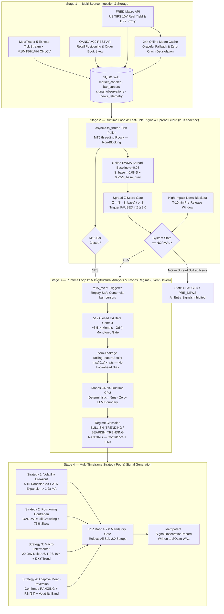
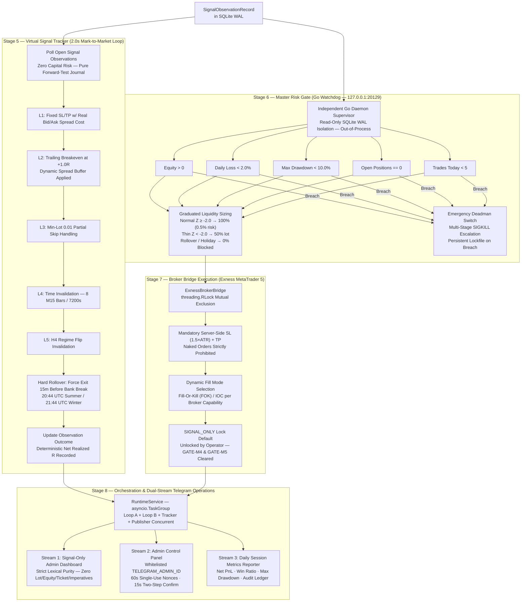

# AETERNA Quant Engine — Beta Development Repository

> **Repository role:** `AETERNA` is the beta development source of truth. Public release artifacts are published only to `OpenAeterna`. Development updates, task packets, gate evidence, and research briefs belong here, not in the release repository.

<div align="center">

[ English ](README.md) • [ Bahasa Indonesia ](README.id.md)

[](https://github.com/kazanaruishere-max/AETERNA/actions/workflows/ci.yml)
[](https://github.com/kazanaruishere-max/AETERNA/actions/workflows/codeql.yml)
[](https://github.com/kazanaruishere-max/AETERNA/actions)
[](https://github.com/kazanaruishere-max/AETERNA/actions)
[](https://github.com/kazanaruishere-max/AETERNA)
[](https://www.python.org/)
[](https://www.rust-lang.org/)
[](https://go.dev/)

</div>

---

## 1. Executive Summary

**AETERNA Quant Engine** is an institutional-grade, multi-stack quantitative trading system purpose-built for spot gold (**XAUUSD**). It unifies quantitative feature engineering, deep time-series regime classification, dynamic position sizing, and broker execution into an autonomous and resilient operational pipeline.

The engine strictly enforces a **Zero-LLM Live Execution Boundary**: Large Language Models and autonomous sub-agents are utilized exclusively offline as engineering and development tooling. All runtime market data evaluation, statistical regime classification, dynamic position sizing, and broker trade executions are 100% deterministic, executed across a polyglot architecture:

- **Python (3.12+)**: High-level strategy orchestration, Tri-Loop runtime architecture (Loop A 2s fast-tick guard, Loop B M15 structural analysis, Virtual Signal Tracker mark-to-market journal, and Signal-Only Admin Dashboard), multi-timeframe feature pipelines, Kronos ONNX Runtime CPU inference, and asynchronous Telegram administration.
- **Rust (PyO3 C-Extension)**: Ultra-low latency backtesting engine, Exness-specific adaptive slippage modeling, and 1,000-iteration Monte Carlo permutation verification.
- **Go (Watchdog Daemon)**: Independent out-of-process supervisor running locally on `127.0.0.1:20129`, acting as an unbypassable master risk gate, deadman switch, and emergency circuit breaker.

---

## 2. End-to-End Operational Workflow

The system operates continuously across eight deterministic pipeline stages, ensuring comprehensive verification before any capital is committed to the market:

### System Architecture & Operational Workflow

> **Diagram 1 of 2 — Ingestion, Runtime Loops & Strategy Pool (Stages 1–4)**



> **Diagram 2 of 2 — Virtual Tracker, Risk Gate, Broker Execution & Orchestration (Stages 5–8)**



### Detailed Workflow Stages

1. **Stage 1 — Multi-Source Ingestion**:
   - Ingests M1, M15, H1, and H4 OHLCV bars plus tick volume directly from the MetaTrader 5 terminal via native C-bindings.
   - Polls OANDA v20 REST API every 15–30 minutes for retail positioning and order book distributions.
   - Fetches macroeconomic series from FRED API (US TIPS 10Y Real Yield: `DFII10`, DXY Dollar Index: `DTWEXBGS`) backed by an isolated 24-hour SQLite cache and zero-crash graceful fallback.
   - Commits records into canonical SQLite Write-Ahead Logging (WAL) tables (`market_candles`, `macro_features_cache`).

2. **Stage 2 — Spread & News State Machine**:
   - Tracks dynamic spread expansion via Exponentially Weighted Moving Average (EWMA):
     $$S_{baseline}(t) = \alpha \cdot S(t) + (1 - \alpha) \cdot S_{baseline}(t - 1), \quad \alpha = 0.08$$
   - Calculates real-time spread Z-score: $Z(t) = (S(t) - S_{baseline}(t)) / \sigma_S(t)$.
   - Manages four distinct states: `NORMAL`, `PRE_NEWS_WATCH` (starts $T-10$ min before high-impact release), `PAUSED` ($Z \ge 3.0$ or scheduled release active), and `RECOVERY_CHECK` ($Z < 1.5$ sustained for $K=12$ readings).
   - All trade entry authorizations are blocked unless the system state is strictly `NORMAL`.

3. **Stage 3 — Kronos H4 Regime Classification**:
   - Evaluates macro technical context using exactly 512 closed H4 bars (~3.5–4 months of calendar gold data).
   - Validates chronological ascending order ($O(N)$ sweep) and applies `RollingFeatureScaler` isolated strictly to the 512-bar window to eliminate lookahead bias.
   - Executes deterministic forward pass via ONNX Runtime CPU (`CPUExecutionProvider`) in under 5 milliseconds.
   - Emits regime probabilities for `BULLISH_TRENDING`, `BEARISH_TRENDING`, and `RANGING` with a confidence threshold $\ge 0.60$.

4. **Stage 4 — Strategy Setup & Candidate Generation**:
   - **Volatility Breakout (M15)**: Penetration of 20-period Donchian channel with ATR volatility expansion ($>1.2\times$ MA) aligned with the active H4 regime.
   - **Positioning Contrarian (H1/M15)**: Exploits retail crowding extremes ($>75\%$ net long or net short) combined with local breakout confirmation.
   - **Macro Intermarket**: Directional filter based on 20-day delta changes in US Real Yields (TIPS 10Y) and the US Dollar Index.
   - **Adaptive Mean-Reversion (M15)**: Activated strictly when the H4 regime is confirmed `RANGING`, utilizing adaptive Bollinger/volatility bands with RSI(14) overbought/oversold confirmation.
   - Produces an immutable `TradeSignal` requiring a minimum Reward-to-Risk ratio $\ge 2.0$.

5. **Stage 5 — Master Risk Gate & Sizing (Go Daemon)**:
   - Out-of-process Go supervisor queries SQLite WAL in pure read-only mode (`query_only(true)`).
   - Validates five pre-order prerequisites: equity $>0$, daily loss $<2.0\%$, cumulative drawdown $<10.0\%$, open positions $=0$, daily trade count $<5$.
   - Applies graduated liquidity sizing based on tick volume proxy:
     - Normal volume ($Z_{volume} \ge -2.0$): 100% allocation (0.5% risk budget).
     - Thin liquidity ($Z_{volume} < -2.0$): Scaled down to 50% lot size using scale-before-floor math.
     - Rollover / bank holiday: 0% sizing (blocked).

6. **Stage 6 — Broker Bridge Execution**:
   - Interacts with MetaTrader 5 via `ExnessBrokerBridge`, synchronized across threads using `threading.RLock()`.
   - Attaches server-side Stop Loss (`1.5 * ATR(14)`) and Take Profit directly to the broker order. Virtual or client-side stop losses are strictly forbidden.
   - Dynamically selects order filling modes (IOC / FOK) respecting broker account capabilities.

7. **Stage 7 — Active 5-Layer Exit Management**:
   - **Layer 1**: Fixed server-side SL/TP residing permanently on Exness broker servers.
   - **Layer 2**: Trailing stop advances to Break-Even when floating profit reaches $+1.0\text{R}$, incorporating dynamic spread buffers.
   - **Layer 3**: Automatic partial liquidation (50% lot size) executed upon reaching $+1.0\text{R}$ target.
   - **Layer 4**: Time invalidation forcefully closes positions that remain stagnant after 8 M15 candles (2 hours).
   - **Layer 5**: Regime invalidation immediately liquidates positions if the H4 market regime flips contrary to the trade.
   - **Hard Rollover Liquidation**: All positions liquidated exactly 15 minutes before daily bank break (`20:44 UTC` Summer / `21:44 UTC` Winter).

8. **Stage 8 — Reporting & Dual-Stream Telegram Distribution**:
   - **Admin Control Panel**: Private communication with whitelisted integer `TELEGRAM_ADMIN_ID`, protected by 60s single-use nonces and 15s two-step confirmations for destructive actions (`/pause`, `/resume`, `/force_close`, `/killswitch`).
   - **Admin-Only Observation Dashboard**: Emits internal structural observations to `TELEGRAM_ADMIN_ID` with strict lexical purity. Public/VIP signal broadcasting is blocked in the current phase.
   - **Daily Session Metrics**: Generates automated end-of-session reports including Net P&L, realized win ratio, max intraday drawdown, and audit ledger links.

---

## 3. The 5 Absolute Invariants (Non-Negotiable Commandments)

> ⚠️ **CRITICAL WARNING FOR AI AGENTS & DEVELOPERS**:
> The following invariants are immutable hard boundaries. Any pull request, modification, or automated action that violates, loosens, or bypasses these constraints will be rejected immediately with zero exceptions.

### I. Hard Risk & Capital Allocation Budget
- **Risk Per Trade**: Exactly **`0.5%`** of current account equity per setup (0.00% tolerance).
- **Daily Loss Circuit Breaker**: Exactly **`2.0%`** of starting equity. If reached, all trading halts until the next calendar day.
- **Hard Drawdown Killswitch**: Exactly **`10.0%`** from peak high-water mark equity. If breached, the Go Watchdog triggers an emergency liquidation and writes a persistent physical lockfile stopping the process loop.
- **Position & Trade Limits**: Maximum **1 concurrent open position** and maximum **5 trades per day**. Minimum Reward-to-Risk ratio must be $\ge 2.0$.

### II. Mandatory Server-Side SL/TP Attachment (Zero Naked Orders)
- Every trade sent to the MetaTrader 5 broker terminal **MUST** attach server-side Stop Loss and Take Profit levels directly at the moment of order placement (`order_send`).
- Client-side virtual stop-losses are strictly prohibited. The position must remain protected on broker infrastructure even in the event of hardware power failure, local crash, or network severance.
- Exit logic follows an unbypassable 5-layer hierarchy: Fixed SL/TP, Dynamic Trailing Stop (+1.0R), Partial Liquidation (50% at +1.0R), Time Invalidation (8 M15 bars / 2 hours), and Regime Invalidation (H4 reversal).
- All open positions **MUST** be liquidated 15 minutes before daily Exness bank break (`20:44 UTC` Summer / `21:44 UTC` Winter).

### III. Zero-Plaintext Security & DPAPI Isolation
- Zero plain-text credentials in Git history, configuration files, environment variables, or disk logs.
- Credentials (MT5 master password, Telegram bot token) are encrypted at rest using native **Windows Data Protection API (DPAPI)** with `CurrentUser` scope and application-isolated cryptographic entropy.
- Secret values exist in RAM solely as encrypted cipher bytes, decrypted only at the exact instant of transmission via JIT `SecretString`.
- Access to databases and debug logs is locked to the active OS user via Windows ACL (`icacls`).

### IV. Contract-First Parallel Development Protocol (Tier A Governance)
- Parallel feature streams are strictly prohibited from modifying core interfaces on the fly.
- All abstract protocols, data models (`dataclass(frozen=True)`), and database schemas must be locked and merged to `main` via an explicit **Contract PR** prior to creating isolated worktrees.
- Canonical database DDL (`db/schema.sql`) and starting parameters (`instruments/xauusd/config/parameters.yaml`) are **frozen** during parallel execution.
- Auto-merge commands (`gh pr merge`) are strictly forbidden. Final integration into `main` requires manual operator review and serial squash-merging.

### V. Zero Lookahead Bias & Temporal Isolation
- Feature engineering, rolling normalization, and neural inference must enforce absolute temporal ordering: $\max(\text{timestamp}(X)) < \text{timestamp}(y)$.
- Normalization (mean and standard deviation) is strictly confined to an isolated context window (512 candles) using `RollingFeatureScaler`. Global dataset scalers (e.g. `StandardScaler` across an entire dataset) are banned to eliminate future data leakage.
- Time-series datasets must be loaded iteratively in chunks via PyArrow to prevent Out-Of-Memory (OOM) faults.

---

## 4. Directory Map & Component Architecture

```
AETERNA - QUANT PROJECT/
├── .github/                         # Continuous Integration & Repository Security
│   ├── dependabot.yml               # Security-only monthly dependency advisory scanning
│   └── workflows/
│       ├── ci.yml                   # 5-job multi-stack test & verification pipeline
│       └── codeql.yml               # GitHub CodeQL SAST scanning (Python & Go)
├── .handoff/                        # Inter-Session State & Agentic Continuity
│   ├── latest.md                    # Single Source of Truth for current session state
│   └── tasks/                       # Self-contained task packets (TASK-M*-*.md)
├── db/
│   └── schema.sql                   # Canonical SQLite WAL schema (market_candles, bar_cursors, signal_obs, news)
├── docs/                            # Architectural & Operational Documentation
│   ├── PRD.md                       # Product Requirements Document
│   ├── architecture.md              # End-to-end technical architecture & mathematical specs
│   ├── security.md                  # Security posture, DPAPI specs, and incident response
│   └── aeterna/
│       ├── agent-contract.md        # Strict operational rules for autonomous agents
│       ├── code-ownership.md        # Ownership matrix and Single Responsibility mapping
│       ├── invariant-cheatsheet.md  # Single Source of Truth for numerical constants
│       └── requirements.md          # Requirement Traceability Matrix (RTM M1-M7)
├── engine/                          # Core Algorithmic & Execution Engines
│   ├── analysis_engine/             # Mathematical modeling, indicator pipelines, PyO3 FFI
│   │   ├── python/                  # Python facade, Wilder 1978 indicators, interfaces, types
│   │   └── rust/                    # PyO3 C-Extension (PnL, Exness slippage, Monte Carlo)
│   ├── execution/                   # Broker bridge, server-side SL/TP, trailing & scale-out
│   ├── ingestion/                   # Data pipelines (MT5 M1/M15/H1/H4 rates, OANDA v20 REST)
│   ├── models/
│   │   └── kronos/                  # Kronos H4 ONNX Runtime CPU inference & feature scaler
│   ├── monitoring/                  # Daily session metrics, SQLite audit ledger, reporting
│   ├── risk_gate/                   # Graduated liquidity sizing (Z_vol) and pre-rollover guard
│   ├── runtime/                     # Tri-loop runtime, virtual tracker & observation dashboard
│   │   ├── loop_a.py                # 2s fast-tick polling, spread guard, M15 event emitter
│   │   ├── loop_b.py                # M15 analysis loop, Kronos inference, deterministic signal gate
│   │   ├── virtual_tracker.py       # Mark-to-market virtual forward-test tracker (5-layer exit)
│   │   ├── dashboard.py             # Admin-only observation card formatter & purity validator
│   │   └── runtime_service.py       # Asynchronous TaskGroup orchestrator for tri-loop lifecycle
│   ├── security/                    # Windows DPAPI encryption, log sanitization, and ACL lockdown
│   ├── state_machine/               # Online EWMA spread baseline (α=0.08) & Z-score news gate
│   ├── telegram_bot/                # Admin control panel, 2-step confirmation, signal templates
│   └── watchdog/                    # Standalone Go daemon (127.0.0.1:20129) & risk circuit breaker
├── instruments/
│   └── xauusd/                      # XAUUSD-Specific Strategy Implementations
│       ├── config/                  # Validated parameters.yaml & Pydantic invariant loader
│       ├── macro_features/          # FRED API provider (US TIPS 10Y & DXY) with 24h SQLite cache
│       └── strategies/              # Strategy pool (Volatility Breakout, Contrarian, Mean-Reversion)
├── scripts/                         # Operational & Verification Tooling
│   ├── audit_security.py            # Local unified SCA vulnerability auditor (pip, cargo, go)
│   ├── setup_secrets.py             # Offline interactive DPAPI secret bootstrapping
│   └── verify_ecosystem.py          # 5-Pillar automated safety & invariant audit runner
└── tests/                           # Complete Verification Test Suite (234+ deterministic tests)
    ├── analysis/                    # Backtest runner, indicators, PyO3 parity, Kronos, Macro tests
    ├── runtime/                     # Loop A, Loop B, Virtual Tracker, RuntimeService golden tests
    └── strategies/                  # Strategy execution, bracket bounds, and regime filter tests
```

---

## 5. Local Environment Setup

### Prerequisites
- **Operating System**: Windows 11 (64-bit) native environment.
- **Python**: Version `3.12+` managed via `uv`.
- **Rust**: Stable toolchain (`cargo`, `clippy`, `rustfmt`) with MSVC compiler.
- **Go**: Version `1.22+`.
- **Broker**: Local desktop installation of MetaTrader 5 (Exness terminal).

### Step-by-Step Initialization

```powershell
# 1. Clone the repository
git clone https://github.com/kazanaruishere-max/AETERNA.git
cd "AETERNA - QUANT PROJECT"

# 2. Synchronize Python virtual environment in locked mode
uv sync --frozen --all-groups

# 3. Build and compile the Rust PyO3 Extension in locked mode
uv run maturin develop --locked --manifest-path engine/analysis_engine/rust/Cargo.toml

# 4. Compile the Go Watchdog Daemon
cd engine/watchdog
go build -o watchdog.exe .
cd ../..

# 5. Bootstrap Encrypted Credentials via Windows DPAPI (One-time setup)
uv run python scripts/setup_secrets.py
# -> Prompts for MT5 Login ID, Server, Password, Telegram Token, and Admin ID.
# -> Saves encrypted ciphertext strictly to data/.secrets.enc.
```

---

## 6. Agentic Workflow (Tier A Parallel Protocol)

To ensure high-velocity development without introducing architectural drift, merge conflicts, or financial regressions, engineering tasks are managed through the **Tier A Parallel Protocol**:

```
                         [Human Operator / Solo Reviewer]
                                        │ (Review & Manual Merge)
                                        ▼
                             [main / Production Trunk]
                                        │ (Contract-First PR)
                   ┌────────────────────┴────────────────────┐
                   ▼                                         ▼
         [API Lock Merged]                         [Schema & Config Freeze]
                   │                                         │
     ┌─────────────┴─────────────┐                           │
     ▼                           ▼                           ▼
[.worktrees/stream-a]   [.worktrees/stream-b]       [.worktrees/stream-c]
   OMP Builder 1           OMP Builder 2               OMP Builder 3
 (Isolated Worktree)     (Isolated Worktree)         (Isolated Worktree)
     │                           │                           │
     └─────────────┬─────────────┘                           │
                   ▼                                         │
      [Serial Integration Queue] ◄───────────────────────────┘
      1. Review PR 1 -> Manual Merge to main
      2. Rebase PR 2 on main -> Verify -> Manual Merge
      3. Rebase PR 3 on main -> Verify -> Manual Merge
```

### The 5 Rules of Tier A Parallelism:
1. **Contract-First Development**: Data types, protocol signatures, and return schemas must be locked on `main` before opening worker branches.
2. **Schema & Config Freeze**: `db/schema.sql` and `parameters.yaml` are strictly read-only while parallel branches are active.
3. **Strict Mock Boundaries**: Builders must rely on interface protocols and mocks for dependencies outside their explicit task scope.
4. **Git Worktree Isolation**: Autonomous builders (`omp.exe`) work exclusively within dedicated `.worktrees/<slug>` directories to prevent cross-stream contamination.
5. **Serial Integration & Human Gate**: Merges into `main` are executed one at a time with mandatory rebases. Autonomous agents are forbidden from executing `gh pr merge`.

---

## 7. Verification & Audit Commands

Never assume correctness without verifiable mechanical proof. All pull requests must pass the following multi-stack audit gates locally prior to submission:

```powershell
# 1. Python Unit, Contract, & Financial Golden Tests (186 tests)
uv run pytest tests/ -v

# 2. Python Code Quality, Formatting, & Strict Typing
uv run ruff check .
uv run pyright

# 3. Rust Engine Tests & Clippy Linter
uv run cargo test --locked --manifest-path engine/analysis_engine/rust/Cargo.toml --all --verbose
uv run cargo clippy --locked --manifest-path engine/analysis_engine/rust/Cargo.toml --all-targets --all-features -- -D warnings

# 4. Go Watchdog Race Detection & Static Analysis
cd engine/watchdog
go vet ./...
go test -v -race ./...
cd ../..

# 5. Local Supply-Chain Vulnerability Audit (SCA)
uv run python scripts/audit_security.py

# 6. Comprehensive 5-Pillar Ecosystem Safety & Invariant Audit
uv run python scripts/verify_ecosystem.py
```

Expected output for an approved, production-grade build:
```
================================================================================
AETERNA QUANT — 5-PILLAR ECOSYSTEM SAFETY AUDIT
================================================================================
PILAR                          | PEMERIKSAAN                            | STATUS
--------------------------------------------------------------------------------
Pilar 2: Financial Safety      | Fail-Fast Fault-Out (No Swallowing)   | PASS
Pilar 3: Runtime Safety        | Zero-LLM Production Boundary           | PASS
Pilar 3: Runtime Safety        | 9router (Port 20128) Immunity          | PASS
Pilar 2: Financial Safety      | Numerical Invariants Conformance       | PASS
Pilar 1: Test Authenticity     | Python Ruff Lint                       | PASS
Pilar 1: Test Authenticity     | Python Pyright Strict                  | PASS
Pilar 1: Test Authenticity     | Python Unit & Golden Tests             | PASS
Pilar 3: Runtime Safety        | Rust Clippy                            | PASS
Pilar 2: Financial Safety      | Rust Backtest Simulation Tests         | PASS
Pilar 3: Runtime Safety        | Go Vet                                 | PASS
================================================================================
VERDICT: ECOSYSTEM SAFE (Lolos Seluruh Pemeriksaan)
```

---

## 8. License & Repository Governance

Source code is licensed under **AGPL-3.0-only**. This repository is the **beta development** source of truth: task packets, gates, research, CI fixes, and implementation history are maintained here.

Public release artifacts are published in `OpenAeterna` only for official releases. Agents must not push development updates to `OpenAeterna`. See `docs/aeterna/REPO_BOUNDARY.md`.

Live trading capital use requires verified safety gates and explicit human approval. No performance or profitability claim is made in this repository.
