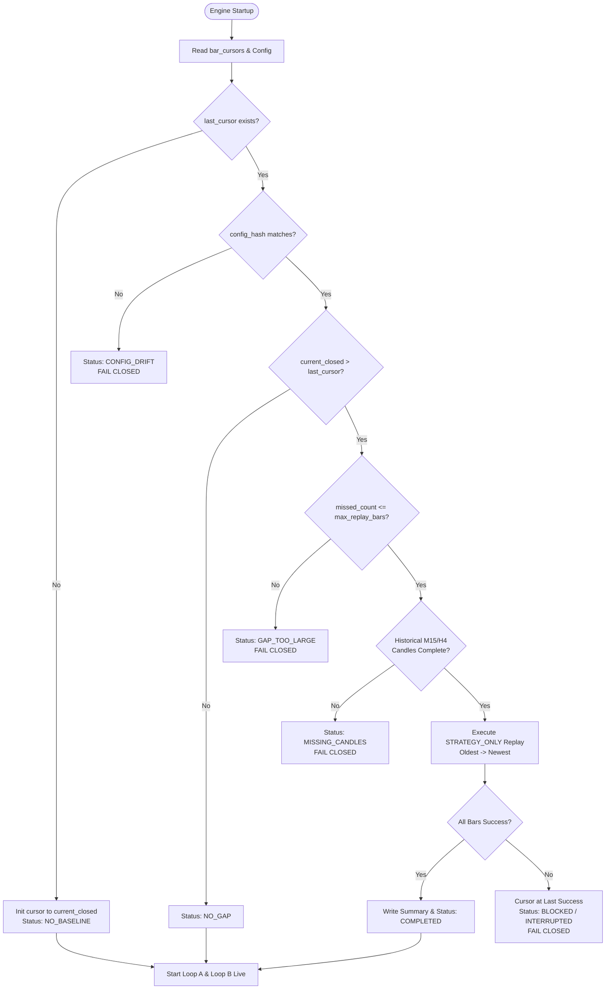

# Restart Gap Replay Architectural Contract — AETERNA Quant

- `contract_id`: CONTRACT-M7-RESTART-GAP-REPLAY
- `plan_id`: PLAN-08 (`.handoff/plans/PLAN-08-RESTART-GAP-REPLAY.md`)
- `task_id`: TASK-M7-RESTART-GAP-REPLAY-CONTRACT (`.handoff/tasks/TASK-M7-RESTART-GAP-REPLAY-CONTRACT.md`)
- `phase`: Phase 0 (Contract / Specification Only)
- `status`: PROPOSED_CONTRACT_ONLY
- `target_milestone`: M7 / P1 Journal
- `covers_req`: [REQ-RUNTIME-001, REQ-RUNTIME-003, REQ-RUNTIME-011]
- `owner`: `aeterna-architect` + `aeterna-risk` + `aeterna-verifier` + human operator
- `created_utc`: "2026-11-23"

---

## 1. Explicit Non-Authorization & Boundary

> [!CAUTION]
> **PHASE 0 CONTRACT ONLY — NO IMPLEMENTATION PERMITTED**  
> This specification defines the mathematical formulas, state machine invariants, data integrity constraints, and test requirements for restart gap detection and replay.  
> 
> In accordance with `AGENTS.md` and `docs/aeterna/AUTONOMOUS_BUILDER.md`:
> 1. **Do NOT write runtime code** in `engine/runtime/*`.
> 2. **Do NOT modify `db/schema.sql`** or execute DDL against `data/trading.db`.
> 3. **Do NOT implement replay logic**.
> 4. **Do NOT modify or transmit** `order_send`, `PositionModify`, or interact with broker trading endpoints.
> 5. **Do NOT terminate, restart, or signal 9router port 20128**.
> 6. **Do NOT perform `gh pr merge`, `git merge`, or auto-merge**.
> 7. **Do NOT introduce external dependencies**.
> 8. **Do NOT include secrets, account IDs, tokens, or credentials** in documentation or tests.

This contract serves as the prerequisite gate before any implementation task packet (such as `TASK-M7-RESTART-GAP-REPLAY-IMPLEMENT`) may be considered by the operator.

---

## 2. Problem Statement & Mathematical Formulation

### 2.1 Architectural Context
AETERNA Quant operates a decoupled tri-loop runtime (`ADR-020`):
- **Loop A (`engine/runtime/loop_a.py`)**: High-frequency (1–2s) non-blocking tick poller, responsible for market data ingestion, spread EWMA tracking, news state machine transitions, and IPC heartbeats via `system_state`.
- **Loop B (`engine/runtime/loop_b.py`)**: Event-driven M15 candle evaluation loop. Upon receiving an M15 bar-close event from Loop A, Loop B evaluates Kronos H4 macro regime, calculates multi-timeframe strategy indicators, checks risk gates, and records deterministic virtual journal observations.
- **Cursor Persistence (`db/schema.sql:121-127`)**: Table `bar_cursors` tracks the last evaluated closed candle timestamp (`last_closed_bar_ts`).

### 2.2 Current Runtime Gap Defect
In current runtime code:
1. `engine/runtime/loop_a.py:113-119`: Upon startup, `last_bar_m15_ts` is initialized solely from the first live tick received after process launch.
2. `engine/runtime/loop_b.py:131-163`: Loop B only triggers on the single next closed bar event delivered by Loop A.
3. `engine/runtime/loop_b.py:337-351`: The cursor deduplication check verifies whether `closed_bar_ts <= last_closed_bar_ts` for that single event.

**Consequence**: If the engine process terminates, crashes, or is shut down for maintenance during market hours, any M15 candles that closed during the downtime are never backfilled or evaluated. When restarted, the engine ignores the gap and resumes evaluation only from the subsequent live candle.

### 2.3 Mathematical Gap Formula
Let:
- $T_{\text{now}}$: Current UTC Unix timestamp (seconds).
- $\Delta_{\text{M15}} = 900$: Duration of one M15 bar in seconds.
- $T_{\text{cursor}}$: Value of `bar_cursors.last_closed_bar_ts` for `(symbol, timeframe='M15')`.

The latest closed M15 candle timestamp available at startup, $T_{\text{closed}}$, is calculated as:
$$T_{\text{closed}} = \left( \left\lfloor \frac{T_{\text{now}}}{\Delta_{\text{M15}}} \right\rfloor \cdot \Delta_{\text{M15}} \right) - \Delta_{\text{M15}}$$

The gap evaluation logic is strictly defined as:

```python
M15 = 900
current_closed = (math.floor(now_utc / M15) * M15) - M15
last_cursor = db.get_bar_cursor(symbol, "M15")

if last_cursor is None:
    status = "NO_BASELINE"
elif current_closed <= last_cursor.last_closed_bar_ts:
    status = "NO_GAP"
else:
    first_missed = last_cursor.last_closed_bar_ts + M15
    last_missed = current_closed
    missed_count = ((last_missed - first_missed) // M15) + 1
```

### 2.4 Concrete Timeline Reference Example
From operational downtime recorded on 2026-11-23:
- Last evaluated bar cursor before shutdown: `04:15:00 UTC` ($T_{\text{cursor}} = 1795407300$)
- Last tick logged before engine stop: `04:43:55 UTC`
- Engine restart timestamp: `05:26:48 UTC` ($T_{\text{now}} = 1795411608$)
- Current closed calculation:
  $$\lfloor 05:26:48 / 900 \rfloor \cdot 900 = 05:15:00 \text{ UTC}$$
  $$T_{\text{closed}} = 05:15:00 - 900\text{s} = 05:00:00 \text{ UTC}$$
- Gap range:
  - $T_{\text{first\_missed}} = 04:15:00 + 900\text{s} = 04:30:00 \text{ UTC}$
  - $T_{\text{last\_missed}} = 05:00:00 \text{ UTC}$
  - $\text{missed\_count} = \frac{05:00:00 - 04:30:00}{900} + 1 = 3 \text{ bars}$
  - Missed bars to replay: `04:30 UTC`, `04:45 UTC`, `05:00 UTC`.
- Note on partial bar: Bar `05:15 UTC` (covering `05:15:00` to `05:29:59 UTC`) is not yet closed at `05:26:48 UTC`. It is NOT part of replay. It will close at `05:30:00 UTC` and be processed by the live Loop B.

---

## 3. Gap Detection Edge Cases & Lifecycle States



### 3.1 Edge Case Specifications

1. **`NO_BASELINE` (Uninitialized / Missing Cursor)**:
   - **Condition**: `db.get_bar_cursor(symbol, "M15") is None`.
   - **Behavior**: Engine must not attempt to replay historical bars blindly from timestamp 0 or an arbitrary past epoch.
   - **Action**: Insert baseline row into `bar_cursors` with `last_closed_bar_ts = current_closed`, record log warning `NO_BASELINE_INITIALIZED`, and proceed directly to live monitoring without replay.

2. **`NO_GAP` (Standard In-Window Restart)**:
   - **Condition**: `current_closed <= last_cursor.last_closed_bar_ts`.
   - **Behavior**: Engine restarted within the same bar interval or before the next bar closed.
   - **Action**: Skip replay routine entirely; proceed immediately to start live loops.

3. **`GAP_TOO_LARGE` (Safety Circuit Breaker)**:
   - **Condition**: `missed_count > RESTART_REPLAY_MAX_BARS`.
   - **Behavior**: Prolonged outage (e.g. multi-day offline, extended weekend gap). Blind replay of excessive bars risks cache bloat, stale execution assumptions, and unmonitored backfill load.
   - **Action**: FAIL CLOSED. Do NOT advance cursor. Do NOT start Loop B live. Set state to `GAP_TOO_LARGE`. Require explicit manual operator review.

4. **`CONFIG_DRIFT` (Parameter / Logic Incompatibility)**:
   - **Condition**: `bar_cursors.config_hash != current_runtime_config_hash` or model/strategy mismatch.
   - **Behavior**: Configuration or strategy parameters changed while engine was offline. Historical bars cannot be accurately attributed to a changed parameter baseline.
   - **Action**: FAIL CLOSED. Do NOT execute replay. Do NOT advance cursor. Emit high-priority warning. Require operator resolution.

5. **`MISSING_CANDLES` (Broker / Ingestion Discontinuity)**:
   - **Condition**: Historical candle fetch from broker MT5 bridge returns missing or non-contiguous bars within $[T_{\text{first\_missed}}, T_{\text{last\_missed}}]$.
   - **Behavior**: Missing price data breaks technical indicator continuous series (e.g. ATR(14) rolling window).
   - **Action**: FAIL CLOSED. Do NOT skip missing bars. Cursor remains pinned at the last verified contiguous bar. Status set to `BLOCKED`. Live Loop B is blocked from starting.

6. **`NEGATIVE_GAP` / System Clock Skew**:
   - **Condition**: `current_closed < last_cursor.last_closed_bar_ts`.
   - **Behavior**: System clock stepped backward or NTP desynchronization occurred.
   - **Action**: FAIL CLOSED immediately. Log security/operational alert.

7. **`CRASH_MID_REPLAY` / Recovery from Interruption**:
   - **Condition**: Process terminated while a previous `replay_runs` record was `status = 'RUNNING'`.
   - **Behavior**: Atomic cursor advance ensures that `bar_cursors.last_closed_bar_ts` reflects the last fully committed bar.
   - **Action**: On next launch, mark previous run as `INTERRUPTED`. Compute fresh gap starting from `last_cursor + 900s`. Resume forward without duplicate processing.

---

## 4. Replay Ordering, Cursor Advancement & Idempotency

### 4.1 Chronological Traversal
Replay must proceed strictly forward in time:
$$T_{\text{first\_missed}} \to T_{\text{first\_missed}} + 900\text{s} \to \dots \to T_{\text{last\_missed}}$$

Evaluating out of order or reverse-chronologically is strictly prohibited, as rolling indicator context and regime transitions are unidirectional.

### 4.2 Per-Bar Transactional Cycle
For each bar $t \in [T_{\text{first\_missed}}, T_{\text{last\_missed}}]$:
1. **Deduplication Check**: Verify `_is_processed(symbol, "M15", t)`. If already present in `bar_cursors` or `signal_observations`, log idempotency skip.
2. **Context Assembly**:
   - Ingest historical M15 candle series up to and including $t$.
   - Ingest H4 candles closing strictly at or prior to $t$ (strict zero-lookahead).
3. **Execution**: Evaluate strategy signals and regime filters under Phase 1 `STRATEGY_ONLY` semantics.
4. **Data Persistence**:
   - If signal valid: Insert into `signal_observations` with `origin = 'REPLAY'` and `replay_id`.
   - If blocked by risk/strategy filter: Insert into `blocked_signals` with `origin = 'REPLAY'` and `replay_id`.
5. **Cursor Advancement**: In the same database transaction (or immediately following data write), update:
   $$\text{UPDATE bar\_cursors SET last\_closed\_bar\_ts} = t, \text{config\_hash} = H_{\text{current}} \text{ WHERE symbol} = S \text{ AND timeframe} = \text{'M15'}$$
   Cursor advances **only after successful completion of that specific bar**.

### 4.3 Idempotency Guarantees
- **Observation Deduplication**: `signal_observations` maintains `UNIQUE(symbol, bar_ts, strategy_id)`. Re-evaluating an identical bar will not produce duplicate observations.
- **Blocked Signal Deduplication**: Proposed compound uniqueness guard `(symbol, bar_ts, strategy_id, reason, origin)` ensures re-run resilience.
- **Crash Immunity**: If bar $N$ fails or crashes mid-evaluation, the cursor remains at $N-1$. No duplicate records exist for $N$, and restarting will cleanly re-evaluate $N$.

---

## 5. Provenance & Sample Segregation (LIVE vs REPLAY)

> [!IMPORTANT]
> **STRICT SEGREGATION OF FORWARD TEST SAMPLES**  
> Under `docs/aeterna/agent-state.md` and `VERIFY.md`, the Virtual Journal milestone gate (`GATE-VIRTUAL-JOURNAL`) mandates collection of 50–100 verified **live** market observations. Replay observations must NEVER contaminate live sample counters.

### 5.1 Provenance Flagging
Every record emitted by the replay pipeline must carry explicit provenance metadata:
- `signal_observations.origin`: Must be `'REPLAY'`. (Live runtime sets `'LIVE'`).
- `signal_observations.replay_id`: Foreign key referencing the active `replay_runs.replay_id`.
- `blocked_signals.origin`: Must be `'REPLAY'`.
- `blocked_signals.replay_id`: Foreign key referencing active `replay_runs.replay_id`.

### 5.2 Query Boundaries
Operational and verification queries must enforce explicit provenance filtering:
- **Live Forward Test Qualification**:
  ```sql
  SELECT COUNT(*) FROM signal_observations 
  WHERE origin = 'LIVE';
  ```
- **Historical Gap Replay Audit**:
  ```sql
  SELECT * FROM signal_observations 
  WHERE origin = 'REPLAY' AND replay_id = :target_replay_id;
  ```

Replay observations are partitioned exclusively for backfill audit, gap filling, and model diagnostics. They are legally and procedurally distinct from live execution samples.

---

## 6. Checkpointing: `config_hash`, `strategy_id`, and `model_id`

To prevent parameter poisoning and unverified model drift across restarts, the replay engine requires 3-tier checkpointing:

1. **`config_hash`**:
   - SHA-256 digest of the active canonical configuration parameters (`instruments/xauusd/config/parameters.yaml`).
   - Normalization: Canonical JSON/YAML key serialization before hashing.
   - Stored in `bar_cursors.config_hash` and `replay_runs.config_hash`.
2. **`strategy_id`**:
   - Explicit identifier string of the evaluated strategy logic (e.g. `"volatility_breakout_v1"`).
   - Stored in `replay_runs.strategy_id`.
3. **`model_id`**:
   - Content hash or artifact version string of the Kronos ONNX regime classifier model (e.g. `"kronos_h4_v1.0.0"`).
   - Stored in `replay_runs.model_id`.

**Drift Validation**:
Prior to replaying bar $t$, the engine computes the current runtime fingerprint $(H_{\text{cfg}}, S_{\text{id}}, M_{\text{id}})$. If $H_{\text{cfg}} \neq \text{cursor.config\_hash}$, replay halts with `status = 'CONFIG_DRIFT'`.

---

## 7. Phase 1 Semantics: `STRATEGY_ONLY` Mode vs Full State Replay

### 7.1 Scope of Phase 1 `STRATEGY_ONLY` Replay
Under Phase 1, the replay pipeline executes:
- **Deterministic Technical Indicators**: Rolling ATR(14), M15 high/low channel breakouts computed from closed candles.
- **Zero-Lookahead Macro Regime**: Kronos H4 ONNX model evaluation using 512 historical H4 bars closed at or before $t$.
- **Price/Time Risk Invariants**: Evaluates R:R $\ge 2.0$, stop distance, and Time Invalidation rules.

### 7.2 Why Full State Replay is Explicitly NOT Claimed
In live production:
- High-frequency live tick data drives `engine/state_machine/` spread tracking:
  - Spread baseline EWMA ($\alpha = 0.08$): $S_{\text{baseline}}(t) = 0.08 S(t) + 0.92 S_{\text{baseline}}(t-1)$.
  - Spread Z-score: $Z(t) = \frac{S(t) - S_{\text{baseline}}(t)}{\sigma_S(t)}$.
  - Recovery check state requires $Z(t) < 1.5$ sustained over $K = 12$ consecutive live tick samples.
- Live volume liquidity sizing computes real-time volume Z-scores ($Z_{\text{volume}} < -2.0$).
- Historical database cold storage stores M1/M15 OHLCV bars and peak spread snapshots in `news_telemetry`, but does **NOT** retain continuous microsecond tick sequences across downtime.

> [!WARNING]
> **NO FABRICATED TICK STATE**  
> Synthesizing artificial tick arrival distributions or retroactively guessing the 12-sample recovery counter from M15 candle summaries would violate the core AETERNA invariant against unverified assertions (`agent-contract.md §8`).  
> 
> Therefore, Phase 1 makes **NO CLAIM** of full real-time state machine equivalence. It is strictly designated `STRATEGY_ONLY`. Live state machine transitions are bypassed during historical replay. Full state replay remains deferred to a future plan requiring high-resolution tick telemetry.

---

## 8. Proposed Schema DDL (Phase 0 Review Only — Do NOT Apply)

```sql
-- ============================================================================
-- PROPOSED SCHEMA EXTENSIONS FOR RESTART GAP REPLAY (PHASE 0 DRAFT)
-- DO NOT EXECUTE OR MERGE INTO db/schema.sql UNTIL CONTRACT APPROVAL
-- ============================================================================

-- 1. Replay Run Audit Table
CREATE TABLE replay_runs (
    replay_id TEXT PRIMARY KEY,
    symbol TEXT NOT NULL,
    timeframe TEXT NOT NULL,
    last_cursor_ts INTEGER NOT NULL,
    first_missed_bar_ts INTEGER NOT NULL,
    last_missed_bar_ts INTEGER NOT NULL,
    missed_count INTEGER NOT NULL,
    started_at_utc TEXT NOT NULL,
    finished_at_utc TEXT,
    status TEXT NOT NULL CHECK (status IN ('PENDING','RUNNING','COMPLETED','BLOCKED','INTERRUPTED')),
    replay_mode TEXT NOT NULL CHECK (replay_mode IN ('STRATEGY_ONLY','NEWS_BLOCK_ONLY')),
    config_hash TEXT NOT NULL,
    strategy_id TEXT NOT NULL,
    model_id TEXT NOT NULL,
    observations_created INTEGER NOT NULL DEFAULT 0,
    blocked_created INTEGER NOT NULL DEFAULT 0,
    error_text TEXT
) STRICT;

-- 2. Schema Alterations (Proposed Migration Pattern)
-- Note: SQLite ALTER TABLE ADD COLUMN statements to be formalized in migration script:

-- ALTER TABLE signal_observations ADD COLUMN origin TEXT NOT NULL DEFAULT 'LIVE' CHECK (origin IN ('LIVE','REPLAY'));
-- ALTER TABLE signal_observations ADD COLUMN replay_id TEXT REFERENCES replay_runs(replay_id);

-- ALTER TABLE blocked_signals ADD COLUMN origin TEXT NOT NULL DEFAULT 'LIVE' CHECK (origin IN ('LIVE','REPLAY'));
-- ALTER TABLE blocked_signals ADD COLUMN replay_id TEXT REFERENCES replay_runs(replay_id);

-- ALTER TABLE bar_cursors ADD COLUMN config_hash TEXT;

-- 3. Blocked Signals Deduplication Index (Proposed)
-- CREATE UNIQUE INDEX IF NOT EXISTS idx_blocked_signals_dedup 
-- ON blocked_signals(symbol, bar_ts, strategy_id, reason, origin);
```

---

## 9. Operator Configuration: `RESTART_REPLAY_MAX_BARS`

### 9.1 Absolute Prohibition of Invented Defaults
In accordance with `PLAN-08 §11` and `AUTONOMOUS_BUILDER.md`:
- The configuration parameter `RESTART_REPLAY_MAX_BARS` represents an explicit risk and operational policy decision.
- **The builder harness and system code MUST NOT invent a default value** (e.g. 10, 24, 96).
- If `RESTART_REPLAY_MAX_BARS` is missing, null, or unconfigured in the runtime environment, the engine must immediately fail closed upon startup with error:
  `CONFIG_ERROR: RESTART_REPLAY_MAX_BARS is not set. Operator decision required.`

### 9.2 Configuration Schema Proposal
Proposed environment / runtime parameters:
```bash
RESTART_REPLAY_MODE=auto            # options: auto | off | dry_run
RESTART_REPLAY_MAX_BARS=            # REQUIRED OPERATOR SETTING (No default)
RESTART_REPLAY_STATE_MODE=STRATEGY_ONLY
```

---

## 10. Notification Contract: Admin Summary-Only

To prevent notification floods, channel desensitization, and potential confusion between historical observations and actionable live signals:

1. **Suppression of Per-Bar Alerts**:
   - Replay must operate silently on a per-bar basis.
   - Individual signal observation alerts to Telegram channels are strictly disabled during replay.
2. **Channel Whitelist**:
   - Replay summaries are never posted to public channels, VIP groups, or forward-facing dashboards.
   - Summaries are delivered exclusively to `TELEGRAM_ADMIN_ID` via private direct notification.
3. **Summary Message Format**:
   Exactly one summary message is dispatched upon completion or blockage:

```text
[AETERNA REPLAY AUDIT]
Symbol: XAUUSDm
Downtime Gap: 2026-11-23 04:43:55 UTC → 2026-11-23 05:26:48 UTC
Missed Bars: 3 M15 bars (04:30, 04:45, 05:00 UTC)
Replayed: 3
Observations Created: 0
Blocked Created: 0
Replay Mode: STRATEGY_ONLY
Status: COMPLETED
Duration: 1.42s
```

---

## 11. 15 Required Acceptance Tests (from PLAN-08 §13)

When implementation begins under a future task packet, the test suite must prove all 15 scenarios:

| # | Test Function Name | Preconditions & Scenario Description | Expected Assertion / Boundary |
| :-: | :--- | :--- | :--- |
| 1 | `test_no_gap_when_cursor_current` | `last_cursor == current_closed`. | `missed_count == 0`, status `NO_GAP`, 0 replay rows created. |
| 2 | `test_gap_math_exact_three_bars` | `last_cursor` is 04:15 UTC, `now` is 05:26:48 UTC (`current_closed` = 05:00 UTC). | Exact identification of 3 bars: 04:30, 04:45, 05:00 UTC. |
| 3 | `test_no_baseline_does_not_replay_blindly` | `bar_cursors` table is empty (`last_cursor is None`). | Cursor initialized to `current_closed`, 0 replay bars executed, status `NO_BASELINE`. |
| 4 | `test_gap_too_large_blocks` | `missed_count > RESTART_REPLAY_MAX_BARS`. | Status `GAP_TOO_LARGE`, cursor does not advance, Loop B live startup blocked. |
| 5 | `test_config_drift_blocks` | Active `config_hash` differs from `bar_cursors.config_hash`. | Status `CONFIG_DRIFT`, replay aborted, Loop B live startup blocked. |
| 6 | `test_replay_oldest_to_newest` | Gap spans multiple bars $[T_1, T_2, T_3]$. | Execution log verifies evaluation order strictly $T_1 \to T_2 \to T_3$. |
| 7 | `test_replay_idempotent_on_second_restart` | Engine restarts immediately after successful replay run without new bar close. | Replay discovers `NO_GAP`, 0 duplicate observations or blocked rows written. |
| 8 | `test_crash_mid_replay_resumes_at_last_success` | Simulated crash after bar 1 of 3. Restart engine. | Prior run marked `INTERRUPTED`; new run starts at bar 2; cursor was persisted at bar 1. |
| 9 | `test_replay_does_not_mutate_live_system_state` | Inspect `system_state` IPC / memory state during and after replay. | Live state machine values (spread, news state, tick timestamps) remain untouched. |
| 10 | `test_replay_marks_origin_replay` | Query observations and blocked signals created during replay. | All rows have `origin == 'REPLAY'` and valid `replay_id`. Zero `'LIVE'` rows. |
| 11 | `test_replay_does_not_send_live_observation_alert` | Mock Telegram publisher during 5-bar replay with valid breakout signals. | Live observation alert mock called 0 times; Admin summary mock called exactly 1 time. |
| 12 | `test_zero_lookahead_h4_cutoff` | Evaluate bar at timestamp $T$. Inspect H4 candle feeder context. | Max H4 candle timestamp $\le T$. No future H4 candles accessible to Kronos model. |
| 13 | `test_missing_candles_blocks_not_skips` | Broker candle feeder returns incomplete series with missing candle at $T_2$. | Replay terminates with status `BLOCKED`, cursor halts at $T_1$, does NOT skip to $T_3$. |
| 14 | `test_blocked_signals_deduped` | Replay evaluates bar triggering risk filter twice under failure test harness. | No duplicate entry in `blocked_signals` for `(symbol, bar_ts, strategy_id, reason, origin)`. |
| 15 | `test_replay_summary_counts` | Completed replay run across $N$ bars generating $X$ observations and $Y$ blocked. | `replay_runs` row and Telegram summary payload exactly match $N, X, Y$, and `COMPLETED`. |

---

## 12. Fail-Closed Mechanics & Runtime Safety Guardrails

1. **Live Evaluation Gating**:
   - Live Loop B evaluation is gated behind replay completion.
   - If replay status is `BLOCKED`, `INTERRUPTED`, `GAP_TOO_LARGE`, or `CONFIG_DRIFT`, the engine transitions to `REPLAY_BLOCKED` and halts before starting Loop B.
2. **Absolute Numeric Invariants**:
   - Zero modifications to financial parameters: `risk_per_trade = 0.5%`, `daily_loss = 2.0%`, `max_dd = 10.0%`, `max_positions = 1`, `max_trades = 5`, `min_rr = 2.0`.
   - Replay logic is strictly computational and offline; it has zero access to order generation endpoints (`order_send`, `PositionModify`).
3. **Infrastructure Guard**:
   - 9router port `20128` must never be contacted, terminated, or restarted during gap detection.
   - Zero LLM in runtime path.

---

## 13. Open Decisions for Operator Resolution

| ID | Decision Item | Context & Recommendation | Status |
| :--- | :--- | :--- | :---: |
| **OD-01** | Value for `RESTART_REPLAY_MAX_BARS` | Maximum allowed bars before fail-closed. Recommendation: `32` bars (8 hours) for normal intraday outages. Outages $> 8$ hours require human manual backfill audit. | PENDING_OPERATOR |
| **OD-02** | Research Usage of `origin='REPLAY'` | May offline analytics query `'REPLAY'` observations for backtest statistical validation? Recommendation: Permitted for exploratory research, but strictly excluded from live track records and milestone gates. | PENDING_OPERATOR |
| **OD-03** | Telegram Admin Interactive Override | Should Telegram Admin bot support `/replay_skip` or `/replay_force` commands when stuck in `GAP_TOO_LARGE`? Recommendation: Defer until Phase 3; fail-closed manual config preferred initially. | PENDING_OPERATOR |
| **OD-04** | Deduplication Key for `blocked_signals` | Add compound UNIQUE index on `(symbol, bar_ts, strategy_id, reason, origin)` vs deduplication check in repository. Recommendation: Compound unique index in schema migration. | PENDING_OPERATOR |
